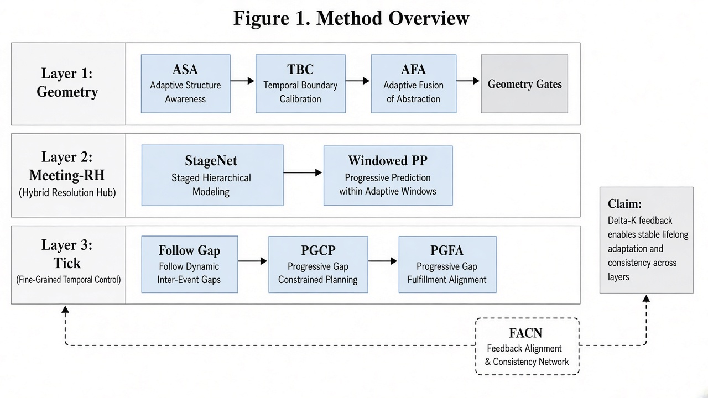
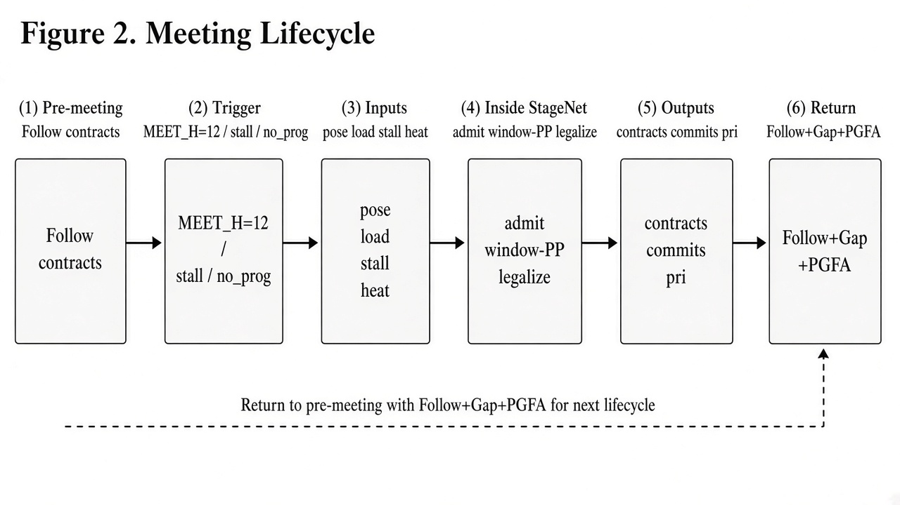
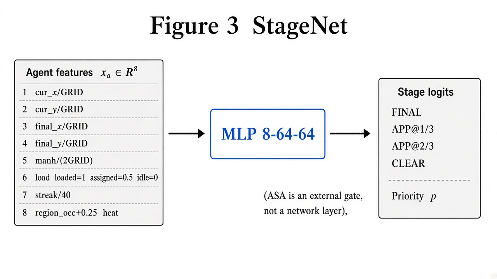
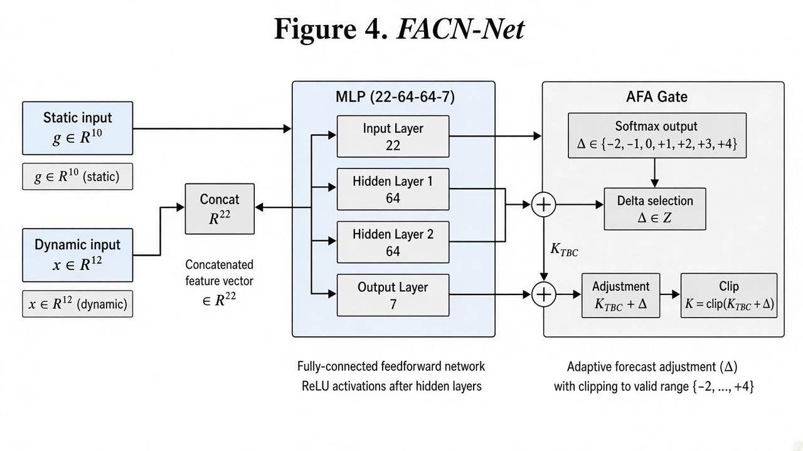

# Explainable Fleet Concurrency Control for Lifelong Multi-Agent Pickup and Delivery via Meeting-based Hybrid Planning

**Abstract.** Lifelong multi-agent pickup and delivery (MAPD) requires continuously assigning and executing pickup–delivery tasks under collision constraints. Search-based windowed solvers such as RHCR with ECBS can achieve high completion rates but incur large wall-clock cost, whereas reactive methods such as PIBT are fast but fragile in capacity-1 corridors. We propose a *Meeting-RH* hybrid stack that separates slow variables—stage pose, priority, and short-horizon commits—from fast conflict repair, and introduces two small imitation-learned modules with geometry gates: **StageNet** selects among FINAL / APPROACH / CLEAR stages and emits a priority scalar, while **FACN** predicts a discrete concurrency residual $\Delta$ that adjusts the throat-band capacity $K=\mathrm{clip}(K_{\mathrm{TBC}}+\Delta)$ without modifying path costs. Geometry-gated protocols (contested-destination gates, pad egress, fleet-gated CEBI, sticky post-unload egress, progress pulses, and focal altruism) map to reproduced failure modes without map-id hardcoding. On a 20-map stress suite with 100 lifelong tasks per map, our method matches ECBS/Hier on VALID and full completion while reducing average simulation time to roughly 42% of hierarchical ECBS and wall-clock by 1–2 orders of magnitude. Ablations show StageNet and corridor protocols are critical for completion on hard maps, whereas FACN primarily improves throughput on open large fleets.

**Keywords:** Lifelong MAPD, Multi-Agent Path Finding, Rolling Horizon, Imitation Learning, Fleet Sizing, Explainable Coordination

---

## 1. Introduction

Multi-Agent Path Finding (MAPF) asks for collision-free paths for multiple agents on a shared graph [@sharon2015cbs; @stern2019mapf]. Automated warehouses and sortation centers typically require the *lifelong* variant: agents repeatedly receive new goals as tasks stream in [@ma2017mapd2; @li2021rhcr]. In lifelong MAPD, planners must jointly handle task progress, corridor capacity, and limited online compute [@chen2024scaling].

Two families dominate practice. **Search-based** methods (CBS/ECBS and their lifelong wrappers) offer strong validity but scale poorly in wall-clock when replanning many agents [@barer2014ecbs; @li2021rhcr]. **Reactive** methods (e.g., PIBT) decide one step at a time and scale, yet degrade in narrow throats and dead-ends [@okumura2022pibt]. Rolling-horizon collision resolution (RHCR) interpolates by resolving conflicts only inside a window [@li2021rhcr], but still pays for joint search in that window and does not explicitly learn *how many* agents should remain busy under heterogeneous geometry.

This paper targets a missing axis of lifelong MAPD control: **operational concurrency**—the number of agents allowed to remain busy—together with **stage pose** (whether an agent should drive to its final goal, an intermediate approach cell, or clear a corridor). These decisions are slow, explainable, and amenable to small supervised models, while fast collision repair can remain algorithmic.

**Contributions.**

1. **Meeting-RH dual timescales.** Periodically (every $H{=}12$ ticks, or on stall/no-progress), a meeting negotiates stages, priorities, and windowed space-time commits; between meetings, agents follow contracts with gap yielding and optional focal altruism.
2. **FACN (Fleet Activation & Concurrency Network).** A compact MLP predicts $\Delta\in\{-2,\ldots,+4\}$ from static geometry and dynamic traffic features; $K=\mathrm{clip}(K_{\mathrm{TBC}}+\Delta)$ gates claiming. FACN does *not* select which agent is busy.
3. **StageNet + ASA.** An MLP scores FINAL / APPROACH@$1/3$ / APPROACH@$2/3$ / CLEAR and a priority; Adaptive Stage Authority (ASA) chooses network vs. teacher from $(n,\textit{near})$.
4. **Geometry-gated protocol suite** addressing reproduced failures (same-destination head-ons, egress–ingress deadlocks, post-unload occupancy, mutual-yield livelocks) without map identifiers.
5. **Empirical evidence** on SH01–20: VALID and full completion on par with ECBS/Hier, with substantially lower simulation makespan and wall-clock; ablations isolate StageNet/protocols for completion and FACN for open-map throughput.

We emphasize that Meeting-RH is **incomplete** relative to CBS: it uses bounded-horizon prioritized space-time BFS and heuristic commitments. Gains are practical Pareto improvements inside the VALID$\land$full-completion regime, not optimality claims.

---

## 2. Related Work

**Optimal and bounded-suboptimal MAPF.** CBS splits conflicts at a high level and replans single-agent paths under constraints [@sharon2015cbs]. ECBS replaces best-first search with focal search to guarantee a user-specified suboptimality bound [@barer2014ecbs; @pearl1982focal]. These solvers underpin many warehouse systems but become expensive under lifelong replanning.

**Prioritized and windowed planning.** Classical prioritized planning assigns agent order and plans sequentially against reservations [@silver2005whca; @cap2015prioritized]. WHCA* commits only inside a window [@silver2005whca]. RHCR decomposes lifelong MAPF into windowed instances and replans every $h$ steps [@li2021rhcr]. Experience-warmed variants accelerate successive queries [@madar2022exrhcr]. Our meetings also use a window, but negotiate *stage* and *concurrency* explicitly and execute with cheap follow between meetings.

**Reactive lifelong solvers.** PIBT uses priority inheritance and backtracking for iterative MAPF/MAPD [@okumura2022pibt]. Learning-augmented lifelong methods combine planning and RL policies [@skrynnik2024follow; @damani2021primal]. We keep learning small and gated for auditability.

**Fleet sizing and congestion.** Competition analyses highlight concurrency, congestion, and myopia as open challenges [@chen2024scaling]. FACN addresses operational $K$ rather than purchasing agents: for a fixed fleet, which subset may claim work.

**MAPD formulations.** Lifelong pickup-and-delivery couples assignment and routing [@ma2017mapd2; @liu2019 lifelong]. Our evaluation uses warehouse-like MAPD streams with FIFO station constraints and vertex/swap conflicts.

---

## 3. Problem Formulation

Let $G=(V,E)$ be a 4-connected grid. A fleet $A=\{a_i\}_{i=1}^{n}$ executes lifelong pickup–delivery tasks. Each agent occupies one cell per discrete time, may wait, and may rotate in place by $\pm 90^\circ$ or $180^\circ$ (each action costs one tick in our motion model). **Vertex conflicts** (two agents in the same cell at the same time) and **edge-swap conflicts** are forbidden. Pickup stations enforce FIFO and at most one pickup per station per tick. A trajectory is **VALID** iff all kinematic, capacity, and conflict constraints hold. Quality metrics: $\textit{done}$ (correct deliveries), $\textit{full100}$ (all tasks done), $\textit{sim}$ (finish time of the last delivery), and $\textit{wall}$ (planner runtime).

We study stress maps SH01–20 with heterogeneous $n$ and throat geometry, each with an official stream of approximately 100 tasks.

---

## 4. Method: Meeting-RH Hybrid Stack

### 4.1 Dual timescales

**Slow (meeting).** A meeting triggers at $t{=}0$, when $t-t_{\mathrm{last}}\ge H{=}12$, when stall$\ge 24$ with gap$\ge 8$, or under dense/sparse no-progress rules. Inside a meeting the stack: (i) builds path caches; (ii) chooses stages via StageNet or teacher (ASA); (iii) applies region soft-admission; (iv) rewrites contested destinations and pad egress (including FG-CEBI/E4 when enabled); (v) runs priority-ordered **windowed space-time BFS** with horizon $W\in\{16,28\}$; (vi) repairs the window; (vii) dual-lexicographic legalization when $10\le n\le 14$; (viii) issues `StageContract`s with TTL${=}16$.

**Fast (inter-meeting).** Agents follow commit heads or waypoints; low-priority agents gap-yield; PGFA may clear the BFS prefix of a single focal beneficiary when stall/streak thresholds fire. Contested-dest and pad-egress also run every tick.

This differs from RHCR [@li2021rhcr]: we do not invoke a full joint windowed MAPF solver every replan period for all conflicts; we negotiate a compact set of slow variables and rely on protocols + local repair.

### 4.2 Geometry gates for capacity and learning

**Multi-Band TBC** sets a static baseline $K_{\mathrm{TBC}}$ from $(n,\textit{near})$ bands (default 6; mid/dense bands lower to 5; mega fleets raise). **FACN** concatenates static $g\in\mathbb{R}^{10}$ and dynamic $x\in\mathbb{R}^{12}$ into $\mathbb{R}^{22}$, scores $\Delta\in\{-2,\ldots,+4\}$, and sets $K=\mathrm{clip}(K_{\mathrm{TBC}}+\Delta)$. **AFA** clips raises/lowers using throat occupancy, same-destination clusters, and stall/no-progress, preventing thrash (e.g., harmful lowers on flood-like maps). Claiming respects $K$; BFS edge costs are untouched.

### 4.3 StageNet

For each agent, candidates include FINAL (goal cell), APPROACH at roughly $1/3$ and $2/3$ along a geometric path, and CLEAR (a nearby low-stay cell). Agent features $x_a\in\mathbb{R}^{8}$ encode normalized position, goal, Manhattan distance, load/assign status, blocked streak, and region occupancy/heat. An MLP ($8{\to}64{\to}64$) with scoring/priority heads outputs stage logits and $p$. Training uses imitation learning (stage CE + listwise priority + fleet regularization). **ASA** switches to a handcrafted teacher on regimes where the net is noisy (e.g., many $n\le 9$ cases).

### 4.4 Protocol suite (summary)

Each tool maps to a failure mode: contested-destination gates prevent same-pad head-ons; pad egress and FG-CEBI enforce egress-before-ingress; E4 sticky egress clears post-unload deg$\le 2$ occupancy on large mid-throat fleets; progress pulses briefly lower $K$ and widen $W$ under no-progress; PGFA prevents mutual-yield livelock by helping one focal agent; DLO reduces hash-order jitter in legalization; region admit soft-caps FINAL density per tile. The umbrella name **PGCP** denotes the corridor-oriented subset.

*Figure 1. Meeting-RH stack: geometry gates, meetings, tick execution, and FACN feedback on $K$.*

*Figure 2. Meeting lifecycle: pre-follow → trigger → inputs → internal steps → contracts → return.*

---

## 5. Experiments

### 5.1 Setup

We evaluate on SH01–20 with official 100-task streams. Baselines: PIBT (reactive), M0 (space-time A* with greedy assignment), PP (priority task allocation + space-time A*), windowed ECBS, and Hier (M0 on easy maps, ECBS handoff on hard maps). Ours: Meeting-RH + protocols + StageNet (ASA) + FACN (AFA). Reproduction: `PYTHONHASHSEED=0`, CPU, per-map subprocess isolation. Primary comparisons require VALID trajectories.

### 5.2 Main results

**Table 1.** Aggregate results on SH01–20 (official 100). Lower sim/wall is better among VALID$\land$full100 methods. † sim on incomplete maps is not comparable as “faster.”

| Method | full100 | VALID | avg_done | avg_sim | avg_wall |
|--------|---------|-------|----------|---------|----------|
| PIBT | 8/20 | 20/20 | 63.9 | 62811 | 40.5s |
| M0 | 4/20 | 20/20 | 44.6 | 942† | 1478s |
| PP | 1/20 | 7/20 | 32.4 | 848† | 1716s |
| ECBS | 20/20 | 20/20 | 100 | 7364 | 543s |
| Hier | 20/20 | 20/20 | 100 | 4018 | 1032s |
| **Ours** | **20/20** | **20/20** | **100** | **1708** | **~28s** |

**Discussion.** PIBT/M0/PP fail to complete many maps; their low sim values are not successes. Among methods that achieve 20/20 full100, Ours reduces avg_sim to ~42% of Hier and ~23% of ECBS, with wall-clock ~28s vs hundreds–thousands of seconds. The speedup stems from (i) infrequent meetings, (ii) bounded-horizon space-time BFS rather than repeated full-goal space-time A*, (iii) concurrency limiting, and (iv) fewer deadlock-induced replans.

Protocol-only improvements vs. a legacy FULL stack on SH01–20 yield about **−9.0%** avg_sim with **0** worse maps. FACN v2 vs. noFACN on SH01–40 yields about **−5.82%** avg_sim (20/13/5 better/same/worse) with GATE maps PASS.

### 5.3 Ablations

Leaving out components (relative to full): disabling StageNet collapses hard maps (e.g., SH10 done 60, SH17 done 32). Disabling PGCP-related corridor tools drops completion on SH10/11/12/17. Disabling PGFA can destroy SH17 (done 20) and inflate sim on SH03. Disabling FACN hurts open large fleets (e.g., SH20 sim 660→813). Global direction-field nets are *not* used in the default stack; when tested historically they did not improve done/sim—hence we do not claim them as a contribution.

*Figure 3. StageNet I/O (8-D agent state listed; ASA is an external gate).*

*Figure 4. FACN I/O: static $g$ and dynamic $x$ → $\Delta$ → $K$.*

### 5.4 Why windowed BFS beats serial M0 A*

Although both touch search, M0 repeatedly runs **full-horizon space-time A*** against a dense reservation table at assignment time. Meeting-RH mostly executes contract following; meetings call **priority-ordered space-time BFS** only inside $W$. Thus call frequency, search depth, and conflict thrash all drop—explaining wall-clock gaps even when “search” remains in the stack.

---

## 6. Limitations and Threats to Validity

Meeting-RH is incomplete and may fail on pathological maps. FACN held-out generalization across map families remains limited. Protocols require maintenance and can interact. Stress maps are not a full industrial digital twin. Results are reported for fixed seeds and CPU; GPU training is offline only.

---

## 7. Conclusion

We presented Meeting-RH, an explainable hybrid for lifelong MAPD that couples geometry-gated protocols with two small networks: StageNet for stage/priority and FACN for operational concurrency $K$. Empirically, the stack matches strong search baselines on validity and completion while substantially improving simulation time and wall-clock. Future work includes stronger held-out concurrency learning, tighter integration with anytime windowed search [@li2021mapflns], and richer kinodynamic models [@chen2024scaling].

---

## References

1. Sharon, G., Stern, R., Felner, A., & Sturtevant, N. R. (2015). Conflict-based search for optimal multi-agent pathfinding. *Artificial Intelligence*, 219, 40–66.

2. Barer, M., Sharon, G., Stern, R., & Felner, A. (2014). Suboptimal variants of the conflict-based search algorithm for the multi-agent pathfinding problem. *SoCS*.

3. Okumura, K., Machida, M., Défago, X., & Tamura, Y. (2022). Priority inheritance with backtracking for iterative multi-agent path finding. *Artificial Intelligence*, 310, 103752.

4. Ma, H., Li, J., Kumar, T. K. S., & Koenig, S. (2017). Lifelong multi-agent path finding for online pickup and delivery tasks. *AAMAS*.

5. Li, J., Tinka, A., Kiesel, S., Durham, J. W., Kumar, T. K. S., & Koenig, S. (2021). Lifelong multi-agent path finding in large-scale warehouses. *AAAI*, 35(13), 11272–11281.

6. Madar, N., Solovey, K., & Salzman, O. (2022). Leveraging experience in lifelong multi-agent path finding. *SoCS*.

7. Silver, D. (2005). Cooperative pathfinding. *AIIDE*.

8. Stern, R., et al. (2019). Multi-agent pathfinding: Definitions, variants, and benchmarks. *SoCS*.

9. Pearl, J., & Kim, J. H. (1982). Studies in semi-admissible heuristics. *IEEE TPAMI*.

10. Chen, Z., et al. (2024). Scaling lifelong multi-agent path finding to more realistic settings. *SoCS*.

11. Skrynnik, A., et al. (2024). Learn to follow: Decentralized lifelong multi-agent pathfinding via planning and learning. *AAAI*.

12. Li, J., et al. (2021). Anytime multi-agent path finding via large neighborhood search. *IJCAI*.

13. Liu, M., Ma, H., Li, J., & Koenig, S. (2019). Task and path planning for multi-agent pickup and delivery. *AAMAS*.

14. Sartoretti, G., et al. (2019). PRIMAL: Pathfinding via reinforcement and imitation multi-agent learning. *IEEE RA-L*.

15. Höenig, W., et al. (2018). Trajectory planning for quadrotor swarms. *IEEE TRO*.

---

## Appendix A. FACN Feature Tables

**Static $g\in\mathbb{R}^{10}$:** $n$, free cells, near_pad_deg2, #pickups, #dropoffs, density, idle-pool ratio, $K_{\mathrm{TBC}}$, region-free mean/max (normalized as in code).

**Dynamic $x\in\mathbb{R}^{12}$:** busy, idle, remaining, done_rate, stall, avg commit $H$, repairs, conflict heat, region occupancy, #dest-gates, same-dest cluster, throat occupancy.

## Appendix B. Reproducibility

Entry point: `python -m greed_coop_mcts` with `policy=rrsc`, optional FACN checkpoint `facn_v2.pt`, StageNet `stage_selector_v1.pt`. Meeting constants: `MEET_H=12`, `MEET_W\in\{16,28\}`.
