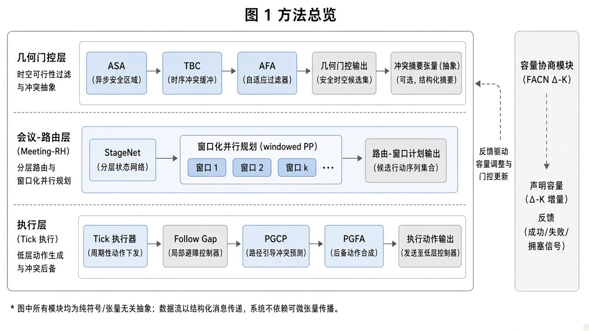
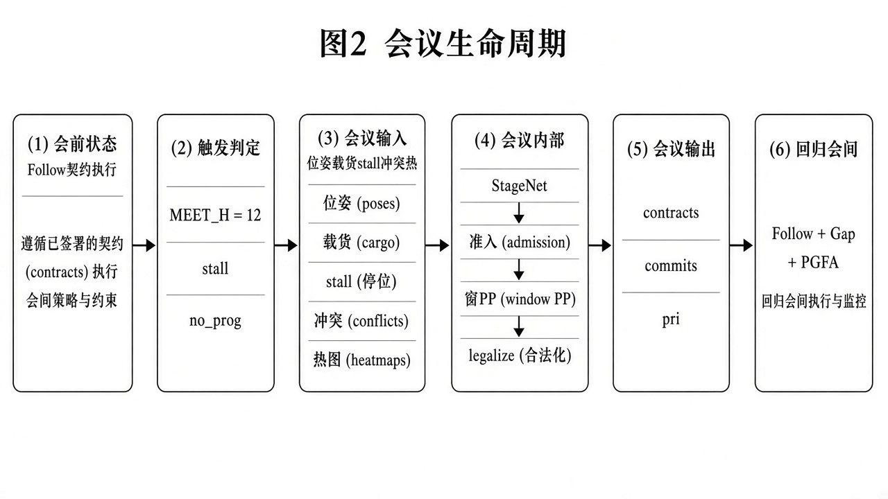
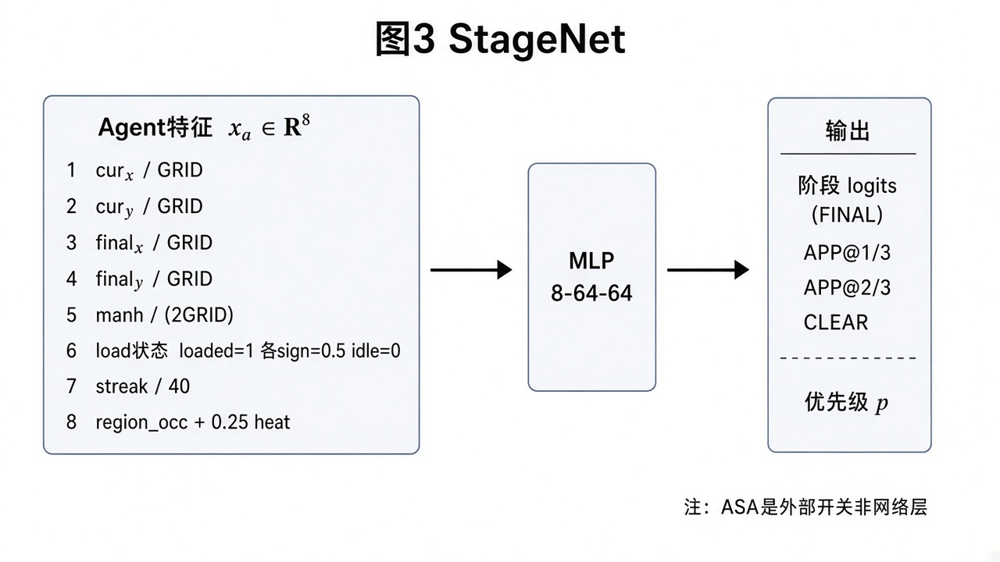
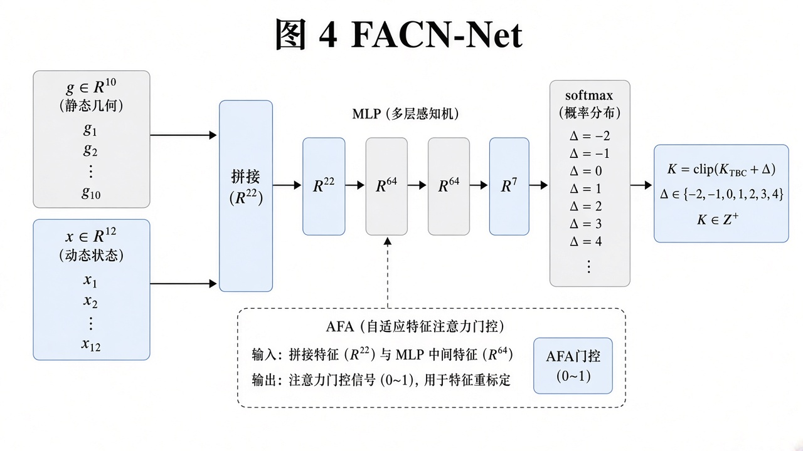

# 面向终身多智体取送货的可解释车队并发控制：基于会商的混合规划

**摘要：** 终身多智体取送货（Lifelong MAPD）要求在碰撞约束下持续分配并执行取货—送货任务。基于搜索的窗口求解器（如 RHCR 结合 ECBS）完成率高但墙钟时间昂贵；反应式方法（如 PIBT）速度快，却在容量为 1 的走廊中脆弱。本文提出 *Meeting-RH* 混合栈：将慢变量——阶段位姿、优先级与短视窗提交——与快速冲突修复分离，并引入两个带几何门控的小型模仿学习模块。**StageNet** 在 FINAL / APPROACH / CLEAR 阶段间选择并输出优先级标量；**FACN** 预测离散并发残差 $\Delta$，将喉带容量调整为 $K=\mathrm{clip}(K_{\mathrm{TBC}}+\Delta)$，且不改动路径代价。几何门控协议（竞争目的地门、垫区出口、车队门控 CEBI、粘性卸货后出口、进度脉冲、焦点利他等）对应可复现失败模式，无需地图 ID 硬编码。在含每图约 100 条终身任务的 20 图压力套件上，本方法在 VALID 与全量完成上与 ECBS/Hier 持平，平均仿真时间约为分层 ECBS 的 42%，墙钟时间降低 1–2 个数量级。消融表明 StageNet 与走廊协议对难图完成至关重要，而 FACN 主要提升开阔大车队吞吐。

**关键词：** 终身 MAPD；多智体路径规划；滚动视窗；模仿学习；车队规模；可解释协同

---

## 1. 引言

多智体路径规划（MAPF）要求共享图上多智体无碰撞路径 [@sharon2015cbs; @stern2019mapf]。仓储与分拣场景通常需要 *终身* 变体：任务流到来时智体反复接收新目标 [@ma2017mapd2; @li2021rhcr]。在终身 MAPD 中，规划器需同时处理任务进度、走廊容量与有限在线算力 [@chen2024scaling]。

实践中两大家族主导。**基于搜索**的方法（CBS/ECBS 及其终身封装）有效性强，但在多智体重规划下墙钟开销大 [@barer2014ecbs; @li2021rhcr]。**反应式**方法（如 PIBT）逐步决策、可扩展，却在窄喉与死胡同中退化 [@okumura2022pibt]。滚动视窗冲突消解（RHCR）仅在窗口内消解冲突 [@li2021rhcr]，但仍为联合搜索付费，且未显式学习异构几何下应允许多少智体保持忙碌。

本文针对终身 MAPD 控制中缺失的一轴：**运营并发度**——允许多少智体保持忙碌——以及 **阶段位姿**（直达最终目标、中间接近点，或清廊）。这些决策慢、可解释、适合小型监督模型；快速碰撞修复可保持算法化。

**贡献：**

1. **Meeting-RH 双时间尺度。** 周期性（每 $H{=}12$ 拍，或停滞/无进展时）召开会商，协商阶段、优先级与窗口时空提交；会商之间按契约执行，配合空隙让行与可选焦点利他。
2. **FACN（车队激活与并发网络）。** 紧凑 MLP 由静/动态特征预测 $\Delta\in\{-2,\ldots,+4\}$；$K=\mathrm{clip}(K_{\mathrm{TBC}}+\Delta)$ 门控认领。FACN **不**选择具体哪辆车忙碌。
3. **StageNet + ASA。** MLP 为 FINAL / APPROACH@$1/3$ / APPROACH@$2/3$ / CLEAR 打分并输出优先级；自适应阶段权威（ASA）依 $(n,\textit{near})$ 在网络与教师间切换。
4. **几何门控协议套件**，针对可复现失败（同目的地对冲、进出口死锁、卸货后占位、互让活锁），无地图标识符。
5. **实证：** SH01–20 上 VALID 与全量完成对标 ECBS/Hier，仿真与墙钟显著更优；消融分离 StageNet/协议对完成率、FACN 对开阔图吞吐的贡献。

需强调 Meeting-RH 相对 CBS **不完备**：采用有界视窗优先时空 BFS 与启发式提交。收益是 VALID$\land$全量完成体制内的实用帕累托改进，而非最优性声明。

---

## 2. 相关工作

**最优与有界次优 MAPF。** CBS 在高层拆分冲突、在约束下重规划单智体路径 [@sharon2015cbs]。ECBS 用焦点搜索保证用户指定次优界 [@barer2014ecbs; @pearl1982focal]。它们支撑诸多仓储系统，但终身重规划代价高。

**优先与窗口规划。** 经典优先规划按序相对预约表规划 [@silver2005whca; @cap2015prioritized]。WHCA* 仅在窗口内提交 [@silver2005whca]。RHCR 将终身 MAPF 分解为窗口实例并每 $h$ 步重规划 [@li2021rhcr]。经验预热变体可加速相继查询 [@madar2022exrhcr]。本文会商也使用窗口，但显式协商 *阶段* 与 *并发度*，并在会商间廉价跟进。

**反应式终身求解器。** PIBT 用优先级继承与回溯做迭代 MAPF/MAPD [@okumura2022pibt]。学习增强的终身方法结合规划与 RL [@skrynnik2024follow; @damani2021primal]。我们保持学习模块小且门控，便于审计。

**车队规模与拥堵。** 竞赛分析突出并发、拥堵与短视等挑战 [@chen2024scaling]。FACN 针对运营 $K$ 而非采购智体：固定车队下允许多少子集认领工作。

**MAPD 形式化。** 终身取送货耦合分配与路由 [@ma2017mapd2; @liu2019lifelong]。评测采用类仓储 MAPD 流、FIFO 工位与顶点/交换冲突。

---

## 3. 问题形式化

设 $G=(V,E)$ 为四连通网格。车队 $A=\{a_i\}_{i=1}^{n}$ 执行终身取送货。每拍一格，可等待，可原地 $\pm 90^\circ$ 或 $180^\circ$ 旋转（本运动模型中各动作耗一拍）。禁止 **顶点冲突** 与 **边交换冲突**。取货站 FIFO，每站每拍至多一次取货。轨迹 **VALID** 当且仅当运动学、容量与冲突约束均满足。质量指标：$\textit{done}$（正确送达数）、$\textit{full100}$（全部完成）、$\textit{sim}$（最后送达仿真时间）、$\textit{wall}$（规划器墙钟）。

评测压力图 SH01–20，异构 $n$ 与喉道几何，每图官方约 100 条任务流。

---

## 4. 方法：Meeting-RH 混合栈

### 4.1 双时间尺度

**慢（会商）。** 触发条件：$t{=}0$；$t-t_{\mathrm{last}}\ge H{=}12$；stall$\ge 24$ 且 gap$\ge 8$；或密/疏无进展规则。会商内：(i) 构建路径缓存；(ii) ASA 选择 StageNet 或教师阶段；(iii) 区域软准入；(iv) 改写竞争目的地与垫区出口（含 FG-CEBI/E4）；(v) 优先级序 **窗口时空 BFS**，$W\in\{16,28\}$；(vi) 窗口修复；(vii) $10\le n\le 14$ 时双字典序合法化；(viii) 签发 TTL${=}16$ 的 `StageContract`。

**快（会商间）。** 跟进提交头或航点；低优先级空隙让行；PGFA 在停滞/连败阈值触发时为单一焦点受益者清 BFS 前缀。竞争目的地与垫区出口亦每拍运行。

相对 RHCR [@li2021rhcr]：我们并不每重规划周期对全部冲突调用完整联合窗口 MAPF；而是协商紧凑慢变量，依赖协议与局部修复。

### 4.2 容量与学习的几何门

**Multi-Band TBC** 由 $(n,\textit{near})$ 带给出静态基线 $K_{\mathrm{TBC}}$（默认 6；中/密带降至 5；超大车队抬升）。**FACN** 将静态 $g\in\mathbb{R}^{10}$ 与动态 $x\in\mathbb{R}^{12}$ 拼接为 $\mathbb{R}^{22}$，打分 $\Delta\in\{-2,\ldots,+4\}$，令 $K=\mathrm{clip}(K_{\mathrm{TBC}}+\Delta)$。**AFA** 依喉占用、同目的地簇与停滞/无进展裁剪升降，防抖动（如洪水类图上有害降低）。认领服从 $K$；BFS 边代价不变。

### 4.3 StageNet

候选含 FINAL（目标格）、沿几何路径约 $1/3$ 与 $2/3$ 的 APPROACH，以及 CLEAR（附近低停留格）。智体特征 $x_a\in\mathbb{R}^{8}$ 编码归一化位姿、目标、曼哈顿距离、负载/分配状态、阻塞连败、区域占用/热度。MLP（$8{\to}64{\to}64$）含打分/优先级头。训练为模仿学习（阶段交叉熵 + listwise 优先级 + 车队正则）。**ASA** 在网络噪声大的体制（如多数 $n\le 9$）切回手工教师。

### 4.4 协议套件（概要）

各工具对应失败模式：竞争目的地门防同垫对冲；垫区出口与 FG-CEBI 强制先出后进；E4 粘性出口清卸货后 deg$\le 2$ 占位（大中喉车队）；进度脉冲在无进展时短暂降 $K$、加宽 $W$；PGFA 帮单一焦点防互让活锁；DLO 降低合法化哈希序抖动；区域准入软限制每瓦片 FINAL 密度。走廊向子集统称 **PGCP**。

*图 1. Meeting-RH 栈：几何门、会商、拍执行与 FACN 对 $K$ 的反馈。*

*图 2. 会商生命周期：预跟进 → 触发 → 输入 → 内部步骤 → 契约 → 返回。*

---

## 5. 实验

### 5.1 设置

SH01–20，官方约 100 任务流。基线：PIBT（反应式）、M0（时空 A* + 贪心分配）、PP（优先任务分配 + 时空 A*）、窗口 ECBS、Hier（易图 M0、难图 ECBS 交接）。本文：Meeting-RH + 协议 + StageNet（ASA）+ FACN（AFA）。复现：`PYTHONHASHSEED=0`、CPU、每图子进程隔离。主对比要求 VALID 轨迹。

### 5.2 主结果

**表 1.** SH01–20（官方 100）汇总。VALID$\land$full100 方法中 sim/wall 越低越好。† 未全完成图上的 sim 不可作“更快”解读。

| 方法 | full100 | VALID | avg_done | avg_sim | avg_wall |
|------|---------|-------|----------|---------|----------|
| PIBT | 8/20 | 20/20 | 63.9 | 62811 | 40.5s |
| M0 | 4/20 | 20/20 | 44.6 | 942† | 1478s |
| PP | 1/20 | 7/20 | 32.4 | 848† | 1716s |
| ECBS | 20/20 | 20/20 | 100 | 7364 | 543s |
| Hier | 20/20 | 20/20 | 100 | 4018 | 1032s |
| **本文** | **20/20** | **20/20** | **100** | **1708** | **~28s** |

**讨论。** PIBT/M0/PP 多图未完成；低 sim 非成功。在 20/20 全完成方法中，本文 avg_sim 约为 Hier 的 42%、ECBS 的 23%，墙钟约 28s 对数百至数千秒。加速来自：(i) 会商稀疏；(ii) 有界视窗时空 BFS 相对反复全目标时空 A*；(iii) 并发限制；(iv) 死锁诱导的重规划更少。

相对旧 FULL 栈，仅协议改进约 **−9.0%** avg_sim 且 **0** 图变差。FACN v2 相对 noFACN（SH01–40）约 **−5.82%** avg_sim（20/13/5 更好/持平/更差），GATE 图通过。

### 5.3 消融

相对完整栈：关 StageNet 难图崩溃（如 SH10 done 60，SH17 done 32）。关 PGCP 走廊工具则 SH10/11/12/17 完成率下降。关 PGFA 可毁 SH17（done 20）并抬高 SH03 sim。关 FACN 伤害开阔大车队（如 SH20 sim 660→813）。默认栈不用全局方向场网络；历史试验未提升 done/sim——故不作为贡献主张。

*图 3. StageNet 输入输出（8 维智体状态；ASA 为外部门）。*

*图 4. FACN 输入输出：静态 $g$ 与动态 $x$ → $\Delta$ → $K$。*

### 5.4 为何窗口 BFS 优于串行 M0 A*

二者虽都触及搜索，但 M0 在分配时反复运行相对稠密预约表的 **全视界时空 A***。Meeting-RH 多数时间契约跟进；会商仅在 $W$ 内调用 **优先序时空 BFS**。调用频率、搜索深度与冲突抖动均下降——即使栈中仍有“搜索”，墙钟差距亦可解释。

---

## 6. 局限与效度威胁

Meeting-RH 不完备，病理地图可能失败。FACN 跨地图族的留出泛化仍有限。协议需维护并可能相互作用。压力图非完整工业数字孪生。结果固定种子与 CPU；GPU 仅离线训练。

---

## 7. 结论

本文提出 Meeting-RH：面向终身 MAPD 的可解释混合方法，将几何门控协议与两个小网络——StageNet（阶段/优先级）与 FACN（运营并发 $K$）——耦合。实证上，该方法在有效性与完成率上对标强搜索基线，同时显著改善仿真时间与墙钟。未来工作包括更强的留出并发学习、与 anytime 窗口搜索的更紧集成 [@li2021mapflns]，以及更丰富的运动学模型 [@chen2024scaling]。

---

## 参考文献

1. Sharon, G., Stern, R., Felner, A., & Sturtevant, N. R. (2015). Conflict-based search for optimal multi-agent pathfinding. *Artificial Intelligence*, 219, 40–66.

2. Barer, M., Sharon, G., Stern, R., & Felner, A. (2014). Suboptimal variants of the conflict-based search algorithm for the multi-agent pathfinding problem. *SoCS*.

3. Okumura, K., Machida, M., Défago, X., & Tamura, Y. (2022). Priority inheritance with backtracking for iterative multi-agent path finding. *Artificial Intelligence*, 310, 103752.

4. Ma, H., Li, J., Kumar, T. K. S., & Koenig, S. (2017). Lifelong multi-agent path finding for online pickup and delivery tasks. *AAMAS*.

5. Li, J., Tinka, A., Kiesel, S., Durham, J. W., Kumar, T. K. S., & Koenig, S. (2021). Lifelong multi-agent path finding in large-scale warehouses. *AAAI*, 35(13), 11272–11281.

6. Madar, N., Solovey, K., & Salzman, O. (2022). Leveraging experience in lifelong multi-agent path finding. *SoCS*.

7. Silver, D. (2005). Cooperative pathfinding. *AIIDE*.

8. Stern, R., et al. (2019). Multi-agent pathfinding: Definitions, variants, and benchmarks. *SoCS*.

9. Pearl, J., & Kim, J. H. (1982). Studies in semi-admissible heuristics. *IEEE TPAMI*.

10. Chen, Z., et al. (2024). Scaling lifelong multi-agent path finding to more realistic settings. *SoCS*.

11. Skrynnik, A., et al. (2024). Learn to follow: Decentralized lifelong multi-agent pathfinding via planning and learning. *AAAI*.

12. Li, J., et al. (2021). Anytime multi-agent path finding via large neighborhood search. *IJCAI*.

13. Liu, M., Ma, H., Li, J., & Koenig, S. (2019). Task and path planning for multi-agent pickup and delivery. *AAMAS*.

14. Sartoretti, G., et al. (2019). PRIMAL: Pathfinding via reinforcement and imitation multi-agent learning. *IEEE RA-L*.

15. Höenig, W., et al. (2018). Trajectory planning for quadrotor swarms. *IEEE TRO*.

---

## 附录 A. FACN 特征表

**静态 $g\in\mathbb{R}^{10}$：** $n$、自由格、near_pad_deg2、取货点数、卸货点数、密度、空闲池比、$K_{\mathrm{TBC}}$、区域自由均值/最大（按代码归一化）。

**动态 $x\in\mathbb{R}^{12}$：** 忙碌、空闲、剩余、完成率、停滞、平均提交 $H$、修复次数、冲突热度、区域占用、目的地门数、同目的地簇、喉占用。

## 附录 B. 可复现性

入口：`python -m greed_coop_mcts`，`policy=rrsc`，可选 FACN 权重 `facn_v2.pt`、StageNet `stage_selector_v1.pt`。会商常数：`MEET_H=12`，`MEET_W\in\{16,28\}`。
